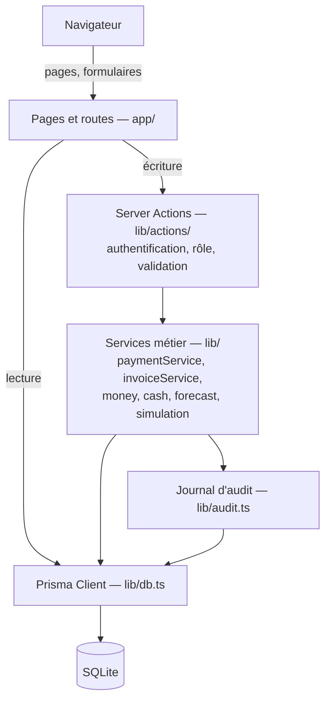
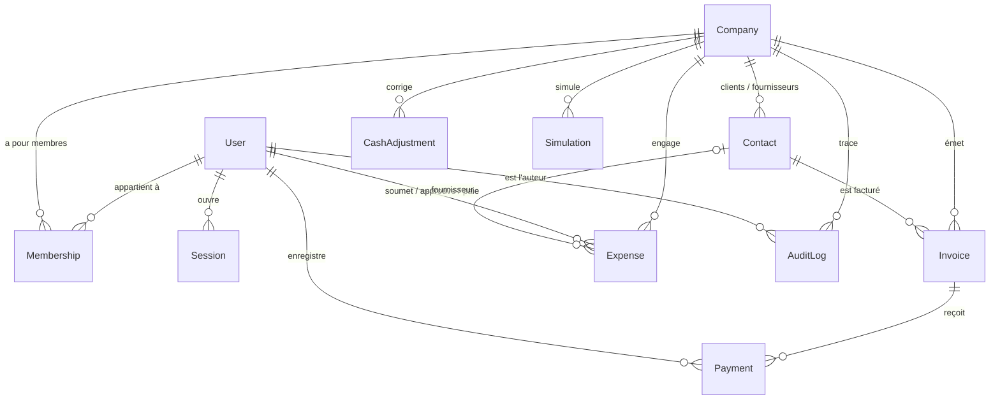
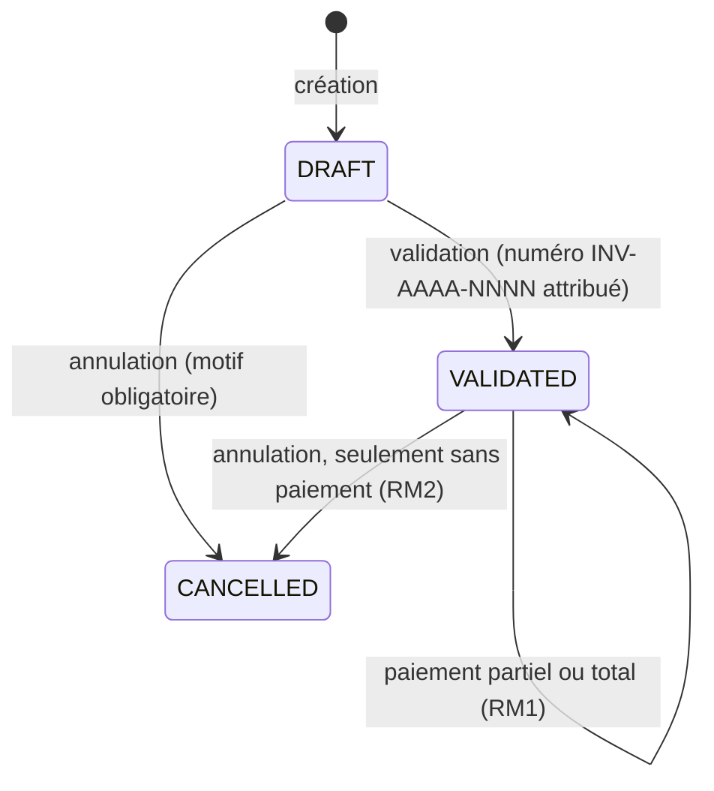
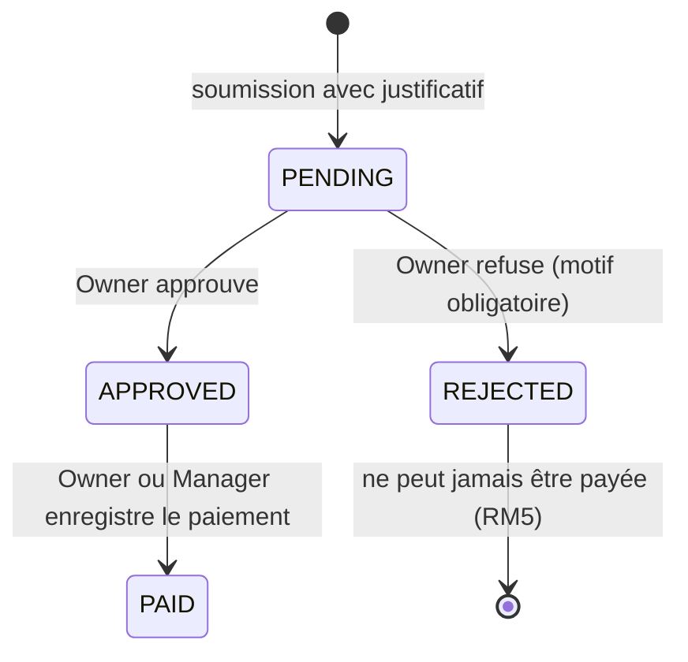

# Rapport de conception – CashPilot

**Projet :** application de gestion de trésorerie pour une petite entreprise de commerce, conforme à la norme ISO/IEC 25010
**Dépôt :** https://github.com/Rayadi-Ayoub/CashPilot-
**Équipe :** Ayoub (chef de projet), Nader, Hassan, Fares
**Date :** 25/11/2026

---

## 1. Présentation

CashPilot suit la trésorerie réelle d'une petite entreprise de commerce qui vend à crédit à des clients professionnels. Les montants sont en dinars tunisiens (DT).

L'application couvre :

- les clients et fournisseurs ;
- les factures clients, avec un workflow de validation ;
- les paiements clients, y compris partiels ;
- les dépenses, avec justificatif et circuit d'approbation ;
- le solde de caisse réel et ses ajustements traçables ;
- les prévisions à 30, 60 et 90 jours, et les simulations « what-if » ;
- un tableau de bord filtrable et un journal d'audit.

**Domaine du cahier des charges :** gestion commerciale / finance (section 3).

## 2. Choix techniques justifiés

| Couche | Choix | Justification |
|---|---|---|
| Frontend + backend | **Next.js 16** (React 19, App Router, Server Actions) | Un seul projet TypeScript pour l'interface et le serveur. Les Server Actions exécutent toutes les écritures côté serveur, où les droits et les règles métier sont vérifiés. |
| Accès aux données | **Prisma 6** | Schéma typé, migrations versionnées, type `Decimal` pour des montants exacts, transactions `Serializable`. |
| Base de données | **SQLite** | Aucun serveur à installer : l'application s'installe à l'identique sur n'importe quelle machine (portabilité, ISO 6.8). Le volume d'une petite entreprise est largement couvert. |
| Authentification | **Sessions serveur** + mots de passe **bcrypt** (coût 12) | Le jeton de session aléatoire (32 octets) est stocké en base et dans un cookie `httpOnly`, `sameSite=lax` et `secure` en production. Une session peut être révoquée côté serveur, contrairement à un JWT. |
| PDF | **pdfkit** | Export PDF des factures, généré côté serveur. |
| Tests | **Vitest** (+ Playwright, k6, Newman, Semgrep, OWASP ZAP selon les rôles) | Vitest exécute le TypeScript du projet directement, avec la couverture de code intégrée. |

**Justification en 3 lignes, pour le rapport :** Next.js et Prisma permettent un projet unique et entièrement typé, où toutes les écritures passent par le serveur et ses contrôles. SQLite rend l'installation reproductible sans serveur de base de données. Les sessions serveur et bcrypt offrent une authentification révocable et robuste.

## 3. Architecture

L'application est organisée en couches. L'interface n'accède jamais directement à la base : toute écriture passe par une Server Action, qui vérifie l'utilisateur et son rôle puis délègue aux services métier.



| Couche | Dossier | Rôle |
|---|---|---|
| Présentation | `app/`, `components/` | Pages (tableau de bord, factures, dépenses, audit…), formulaires, routes PDF et justificatifs protégées |
| Contrôle | `lib/actions/` | Une Server Action par opération d'écriture : contexte utilisateur, contrôle du rôle, validation des champs |
| Métier | `lib/*.ts` | Règles RM1 à RM7, calculs de trésorerie et de prévision, journal d'audit, filtres de recherche |
| Données | `prisma/` | Schéma, 9 migrations versionnées, jeu de données de démonstration |
| Tests | `tests/` | Tests d'intégration et de fiabilité sur une base SQLite séparée (`test.db`) |

## 4. Modèle de données

11 entités, reliées par des relations 1-N et une relation N-N (utilisateurs ↔ entreprises, via `Membership`).



| Entité | Rôle | Contraintes principales |
|---|---|---|
| `User` | Personne qui se connecte | Email unique, mot de passe haché (bcrypt) |
| `Company` | Entreprise (espace de travail) | Solde initial saisi une seule fois (RM7) |
| `Membership` | Lien N-N User ↔ Company, avec le rôle | Unique par couple (utilisateur, entreprise) |
| `Session` | Session de connexion | Jeton unique, date d'expiration (30 jours) |
| `Contact` | Client ou fournisseur | Unique par (entreprise, type, nom) — RM4 |
| `Invoice` | Facture client | Statut DRAFT / VALIDATED / CANCELLED ; numéro unique par entreprise (RM3) |
| `Payment` | Paiement client | Montant `Decimal` > 0, ≤ reste dû (RM1) |
| `Expense` | Dépense avec justificatif | Statut PENDING / APPROVED / REJECTED / PAID (RM5) |
| `CashAdjustment` | Correction de caisse | Montant non nul + motif obligatoire (RM7) |
| `Simulation` | Scénario « what-if » | Ne modifie aucune donnée réelle |
| `AuditLog` | Journal d'audit | Qui (`userId`), quoi (`action`, `entity`, `details`), quand (`createdAt`) ; index par entreprise et date |

Toutes les données sont isolées par entreprise (`companyId`) : chaque requête filtre sur l'entreprise de l'utilisateur connecté.

## 5. Rôles et droits

| Fonction | Owner | Financial manager | Collaborator |
|---|:---:|:---:|:---:|
| Tableau de bord complet, prévisions, simulations | ✅ | ✅ | — |
| Clients, fournisseurs, factures, paiements | ✅ | ✅ | — |
| Solde initial et ajustements de caisse | ✅ | ✅ | — |
| Soumettre une dépense avec justificatif | ✅ | ✅ | ✅ |
| Voir les dépenses | Toutes | Toutes | Les siennes uniquement |
| **Approuver ou refuser** une dépense | ✅ | — | — |
| Marquer une dépense approuvée comme payée | ✅ | ✅ | — |
| Ajouter des membres | ✅ | — | — |
| **Journal d'audit** | ✅ | — | — |

Les droits sont vérifiés côté serveur, dans chaque page et chaque Server Action (`requireManager`, `requireOwner`, `canManage` dans `lib/auth.ts`). Masquer un menu ne suffit pas : une requête directe d'un collaborateur est refusée.

## 6. Workflows à statuts

**Facture**



**Dépense**



Chaque transition est contrôlée côté serveur et écrite dans le journal d'audit.

## 7. Règles métier

Les 7 règles RM1 à RM7, avec l'endroit où elles sont appliquées et leurs tests, sont détaillées dans [`regles-metier.md`](regles-metier.md).

## 8. Calculs de trésorerie

- **Reste dû d'une facture** = total − somme des paiements.
- **Trésorerie réelle** = solde initial + paiements clients − dépenses payées + ajustements de caisse.
- **Prévision à une date** = trésorerie réelle + restes dus des factures validées attendus d'ici là − dépenses approuvées non payées attendues d'ici là. Une échéance déjà dépassée est attendue à partir d'aujourd'hui.
- **Simulation** : la même fonction de projection est appliquée à une copie des flux (retard d'un client, recette ou dépense virtuelle). Aucune donnée réelle n'est modifiée.

Tous les montants utilisent `Prisma.Decimal` : aucune erreur d'arrondi due aux nombres à virgule flottante.

## 9. Qualité intégrée dès la conception (ISO/IEC 25010)

| Caractéristique | Choix de conception |
|---|---|
| 6.1 Aptitude fonctionnelle | Règles métier centralisées dans des services testables (`paymentService`, `invoiceService`) |
| 6.2 Performance | Index sur les colonnes filtrées (`companyId` + statut / date) ; pagination à 25 lignes |
| 6.3 Compatibilité | HTML standard rendu côté serveur, sans dépendance à un navigateur |
| 6.4 Utilisabilité | Messages d'erreur explicites, libellés sur chaque champ, filtres réinitialisables |
| 6.5 Fiabilité | Transactions `Serializable` ; action et ligne d'audit validées ou annulées ensemble ; données persistées dans SQLite |
| 6.6 Sécurité | Contrôle des rôles côté serveur, isolation par entreprise, bcrypt, cookie `httpOnly`, requêtes paramétrées par Prisma (pas d'injection SQL), justificatifs hors du dossier public |
| 6.7 Maintenabilité | Architecture en couches, TypeScript strict, services métier séparés des actions, tests automatisés |
| 6.8 Portabilité | SQLite (aucun serveur), migrations versionnées, données de démonstration reproductibles (`npm run db:seed`) |

## 10. Structure du code

```text
app/                 Pages Next.js, routes PDF et justificatifs protégées
  (workspace)/audit  Journal d'audit (Owner)
components/          Interface partagée : mise en page, formulaires, pagination, graphique
lib/actions/         Server Actions : écritures contrôlées (rôle + validation)
lib/                 Services métier, audit, calculs, filtres, authentification
prisma/              Schéma, migrations, seed de démonstration
tests/integration/   Tests d'intégration et de fiabilité (Vitest + SQLite réelle)
docs/                Rapport de conception, règles métier, matrice, preuves
```
